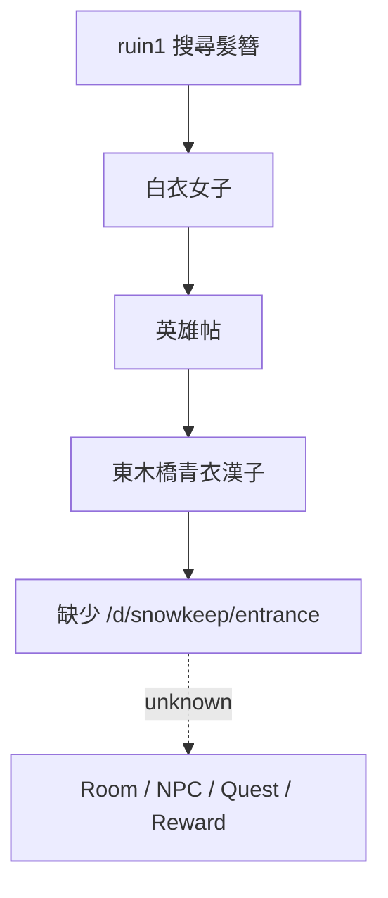

# Original Content Deep Recovery — Phase 3

> Recovery date：2026-09-27  
> Target Branch baseline：`9bb5a54ec839fa4796f5386eddfd0ffe1ea85b56`  
> Pinned Original upstream：`taedlar/es2_mudlib@cc45c06af4852380e5148dad3c9d53ff06854f2c`  
> 原則：`preserve → understand → rebuild → expand`。沒有同版本決定性證據就不建立 Runtime Canon。

## 1. 搜尋邊界

本輪已搜尋：目標 Repository 全樹、目標 Git history、所有可見 branch／tag、刪除／改名歷史、`MANIFEST`、Original archive、Research／Evidence／文件、include／inherit／room／NPC／object／command 引用，以及公開可取得的 ES2 family repositories。

| 來源 | Version / Commit | 搜尋結果 | 相容性 | Confidence |
|---|---|---|---|---|
| `https://github.com/taedlar/es2_mudlib` | pinned `cc45c06a`; 95 commits；`rel-v1.3.0=c4ce59ec`、`rel-v1.4.0=766bcd45` | 三個關鍵字都可回溯至 initial import `936131f` 的殘留引用；所有 tree／tag 都沒有 Snowkeep、`d/fon` 或 challie source | 目標同 lineage／同版本脈絡 | CONFIRMED |
| `https://github.com/mudchina/es2` | `ae8adf6c348ed86fd85edcf418c970bfae1189a2` | 無 Snowkeep、`try/fon`、`__ID_CHALLIE__` 或對應 path | ES2 family；非目標版本 | RELATED / negative result |
| `https://github.com/MudRen/ES2-utf8` | `9ccc9da35cf9e9df86ec4ec43278f1eec251836b`；17 commits | 無三項關鍵 source；其 `d/snow` 是不同 room/NPC 集合 | ES2 family；非目標版本 | RELATED / incompatible content |
| GitHub 全域／公開 Web 精確搜尋 | 2026-09-27 | 精確字串只回到 taedlar 同一批 partial files，未找到第二份實作 | 無可驗證同版本候選 | UNVERIFIED / exhausted |
| Vovo2000／PIXNET 封存 | 已登錄 Archived Source | 支持人物、雪吟莊、封山派及「趙丰血書」名稱存在；沒有 LPC path、旗標轉移、reward 或 room graph | 歷史文字可交叉支持存在性 | PARTIAL |

## 2. Snowkeep Recovery Graph



### CONFIRMED

- `d/snow/npc/guard.c` 接受 `invitation` 後執行 `move("/d/snowkeep/entrance")`。
- `d/snow/ebridge.c` 保存被註解的 east exit，目的地同為 `/d/snowkeep/entrance`。
- `include/explore.h` 配置 `ID_SNOWKEEP=10`。
- Archived Source 支持魚鐵山為雪吟莊莊主；這只證明歷史人物／區域存在性。

### EVIDENCE EXHAUSTED / UNKNOWN

目標上游 initial import、v1.3、v1.4、main 與所有 reachable Git objects 均沒有 `d/snowkeep`。Area rooms、NPC、object、trigger、quest、reward、exit graph 與 precise content 全部 UNKNOWN。本輪不建立空 `entrance.c`，不打開 east exit，也不從版本不相容的外部區域移植。

正式狀態：**BROKEN / UNREACHABLE（target Runtime）＋ EVIDENCE EXHAUSTED（missing content）**。

## 3. `try/fon` Recovery

目標 Source 可確認的狀態片段：

```text
0/1 → 3 → 5    [missing]    8 → 10 → 13 → 15
                                      [missing]
16 → 18        [missing]   40 → 43 → 45 → 48 → 50
```

- `child.c` 與 `gammer.c` 保存 NPC dialogue、交物、follow 與部分 `set_temp`。
- `securityd.c` 的 disabled historical mapping 保存 `/d/fon : newbie`，但 tree 中沒有 `/d/fon`。
- `try/fon` 使用 temporary dbase；現存證據不能推定跨登入保存。
- 缺 `5→8`、`15→16`、`18→40` 呼叫端、完整入口、completion 與 reward。

正式狀態：**PARTIAL SOURCE / EVIDENCE EXHAUSTED / UNKNOWN completion**。`fon` 無足夠證據判定為 room、NPC、helper 或完整 area；不建立假檔。

## 4. `__ID_CHALLIE__` Recovery

`__ID_CHALLIE__` 在目標程式不是 preprocessor macro 使用，而是傳給 `ob->id("__ID_CHALLIE__")` 的**字串 ID**。所以它不是可用 `#define` 修正的 missing macro。

- `child.c`：只在 `try/fon==40` 接受此物，敘事稱「破布」。
- `gammer.c`：只在 `try/fon==43` 接受此物，轉到 state 45。
- PIXNET Archived Gameplay Evidence 記錄「趙丰血書」物件名稱；這能支持物件概念，但不能證明 `__ID_CHALLIE__` 的拼字來源、object path、取得條件、內容或數值。

正式狀態：**PARTIAL historical identity / EVIDENCE EXHAUSTED / UNKNOWN object source**。沒有加入 `#define`，也沒有建立推測物件。

## 5. 貨棧工錢 Runtime Journey

Original call chain：

`store → crate(wage=25) → get → wagon load → temp wage_deserved += 25 → say 工錢 → coin reward`

第一次真 Driver 測試發現：Original foreman 先持有 220 文；新建 25 文後先移到工頭，`COMBINED_ITEM` 合併為 245 文，再由 `give coin` 全數交給玩家。畫面雖說「二十五文」，實得 245 文。

最小 restoration 位於 Expansion compatibility overlay：保留 `wage=25`、所有 command／condition／message，只把 newly-created 25 文直接交給玩家，避免和 NPC 私有 220 文合併。沒有修改 reward 數值或經濟平衡。

隔離 `wageprobe` 真 Driver 已完成：

`Login → Original exits 到貨棧 → get crate → load crate into wagon → wage_deserved=25 → say 工錢 → inventory=25 → save → quit → relogin → inventory=25`

Marker：`ORIGINAL_WAGE_RUNTIME_PASS`。狀態：**RUNTIME PASS**。

## 6. Scholar Runtime Journey

目標同版本 Source 的 teacher chain：

`school → sit → heartbeat teach_literate → commoner + race + int + literate>=5 → pick_student → say 想/是/好 → class=scholar`

決定性 fixture 只預置 Source 明列的 `literate=5` 前置；`sit`、learning progress、pending flag、玩家 `say` relay、`set_class`、save／restore 均由真 Driver 執行。管理診斷只直接呼叫 `pick_student()` 以排除 Original random/chat 排程，不修改挑選機率或正式 Source 條件。

第一次 Runtime 發現 UTF-8 compatibility bug：Big5 時期的 `msg[0..1]` 可擷取一個中文字，UTF-8 下無法等於「想／是／好」。最小修復把相同三個原始回答改為 UTF-8 safe prefix check；沒有新增答案或職業內容。

隔離 `scholarprobe` 已完成：

`Login → Original exits 到私塾 → sit → literate progress → offer → say 想 → class=scholar → save → quit → relogin → class/learned restore`

Marker：`ORIGINAL_SCHOLAR_RUNTIME_PASS`。狀態：**RUNTIME PASS / BOUNDED**；這不代表外部步玄派桃林候選、Scholar class daemon 內容或七職業全集已恢復。

## 7. Phase 3 結論

- Restored：貨棧工錢精確 reward；Scholar UTF-8 回答入口。
- Runtime completed：貨棧工錢、Snow 私塾 Scholar entry 及兩者 save／quit／relogin。
- Kept UNKNOWN：Snowkeep content、`try/fon` 缺失轉移、`__ID_CHALLIE__` object source、外部 Scholar school content。
- 沒有修改冷梅／KING／如來／Score UI；沒有以外部 ES2 family content 倒灌目標 Runtime。
